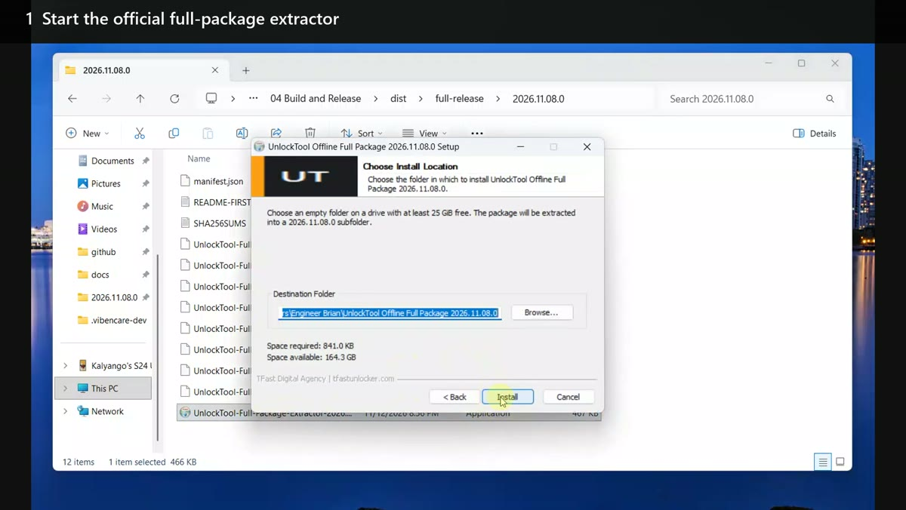
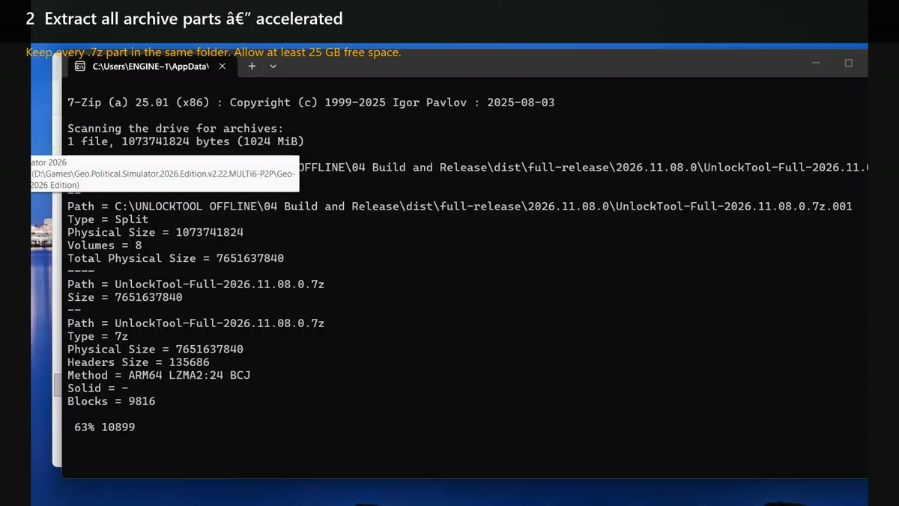
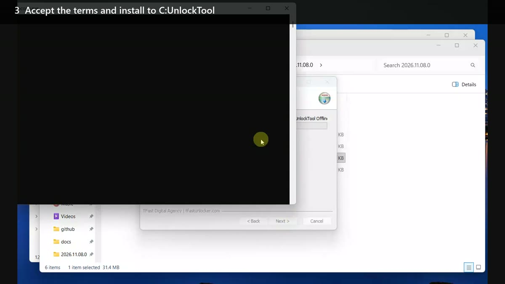
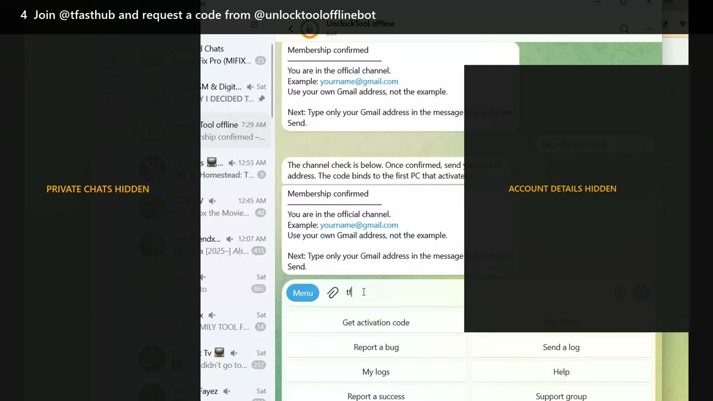
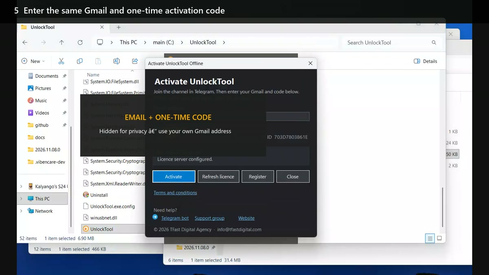
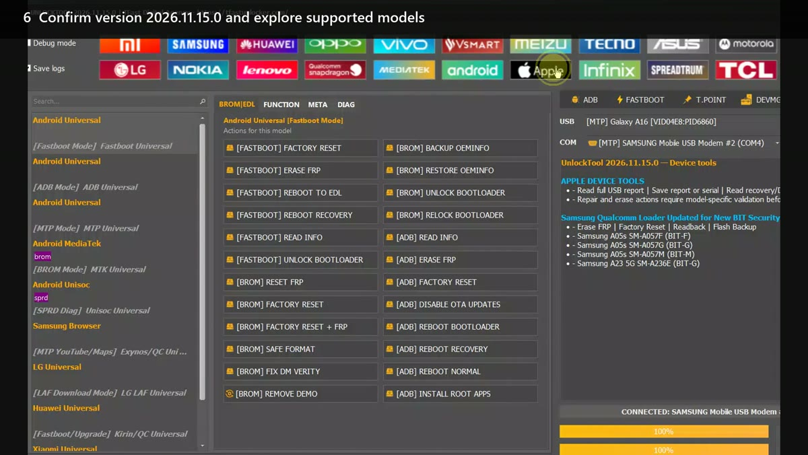

# Install and activate UnlockTool Offline

This is the beginner-friendly written guide for UnlockTool Offline. Complete one step at a time. Do not skip a step when installing for the first time.

**Current application:** 2026.11.15.0  
**Full payload base:** 2026.11.08.0  
**Computer:** Windows 10 or Windows 11, 64-bit  
**Download:** approximately 7 GB  
**Free space required:** at least 25 GB on drive C:

> Never publish your Gmail address, activation code, PC identifier, device IMEI, serial number, or private log.

## Before you begin

Make sure you have:

1. A Windows 10 or Windows 11 64-bit computer.
2. At least 25 GB free on drive C:.
3. Your own working `@gmail.com` address. Temporary email addresses are not accepted.
4. A Telegram account that can join the official channel.

The licence stays attached to the Gmail address and the first PC that activates it.

## Step 1 — Download every release file

Open the [official UnlockTool release page](https://tfastunlocker.com/unlocktool-offline). Download:

- `UnlockTool-Full-Package-Extractor-2026.11.08.0.exe`
- archive parts `.001` through `.008`
- `README-FIRST.txt`
- `manifest.json`
- `SHA256SUMS.txt`
- `UnlockTool-Setup-UNSIGNED-2026.11.15.0.exe`

The complete payload download is about 7 GB.

**You should have:** one extractor, eight numbered archive parts, the current app installer and the verification files.

## Step 2 — Put all eight parts in one folder

Create one folder and move the extractor plus parts `.001` to `.008` into it. Keep every original filename.

**Do not:** open an individual numbered part, rename a part or separate the files.

## Step 3 — Extract the full package

1. Double-click `UnlockTool-Full-Package-Extractor-2026.11.08.0.exe`.
2. Choose a location with at least 25 GB free.
3. Start extraction.
4. Wait until extraction reaches 100%.

Do not close the extractor or shut down the PC while it is working. If extraction reports a missing part, confirm that `.001` through `.008` are together and compare the downloads with `SHA256SUMS.txt`.

## Step 4 — Install the current application

Run `UnlockTool-Setup-UNSIGNED-2026.11.15.0.exe`. Keep the recommended destination `C:\UnlockTool`, finish installation, and open UnlockTool.

The current installer is unsigned. Verify its official filename and SHA-256 value before allowing it. Never use a repacked copy from an unknown source.

Existing users who already have the 2026.11.08.0 payload normally need only the small 2026.11.15.0 app update.

## Step 5 — Join the channel and start the bot

1. Join the official release channel: [@tfasthub](https://t.me/tfasthub).
2. Open the official licence bot: [@unlocktoolofflinebot](https://t.me/unlocktoolofflinebot).
3. Press **Start**.
4. Press the membership confirmation button after joining the channel.

**You should see:** “Membership confirmed” and a request for your Gmail address.

## Step 6 — Request a one-use activation code

Send only your own Gmail address to the bot, for example `yourname@gmail.com`. Do not send the example address literally.

The bot replies with a one-use activation code, licence duration and expiry time. Keep the code private.

## Step 7 — Activate this PC

1. Return to the UnlockTool desktop app.
2. Enter the same Gmail address used in Telegram.
3. Paste the one-use activation code.
4. Press **Activate**.

**Success means:** the app reports an active licence and Telegram sends activation notifications to the user and administrator.

## Step 8 — Confirm the app is ready

Check that the title bar shows version **2026.11.15.0** and that the licence is active. Select the correct brand, model, connection mode and operation before connecting a phone.

After successful activation, supported offline operations do not require a continuous internet connection. Internet is still needed to request or activate a licence, download updates and use online support.

## Common problems

### “Unexpected file: Uninstall.exe”

Install application version 2026.11.15.0. It fixes this false startup warning. You do not need to download the full payload again.

### The runner EXE is missing

Reinstall the current official app update. Check Windows Security protection history in case the file was quarantined. Do not disable security protection.

### The bot still says you must join

Join `@tfasthub` using the same Telegram account, return to the bot, press the membership confirmation button, then press **Start** again.

### The code is invalid or expired

Make sure the Gmail address is identical in the bot and app. Request a new code if the first one expired or was used.

### The phone is not detected

Use a known-good data cable and a direct USB port. Install the correct driver and put the phone into the connection mode required by the selected operation.

## Watch the official video

[Watch the complete installation and activation walkthrough on YouTube](https://youtu.be/gk_cdvRZn0A).

## Official links

- [Written guide on tfastunlocker.com](https://tfastunlocker.com/guides/unlocktool-installation-activation)
- [Official release and download page](https://tfastunlocker.com/unlocktool-offline)
- [Licence bot](https://t.me/unlocktoolofflinebot)
- [Release channel](https://t.me/tfasthub)
- [TFast Digital Agency](https://tfastdigital.com/)

